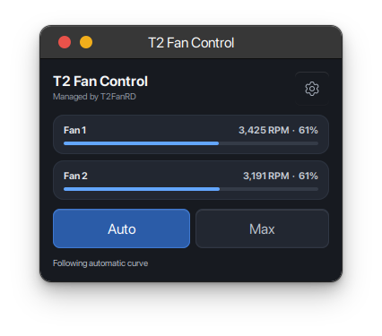
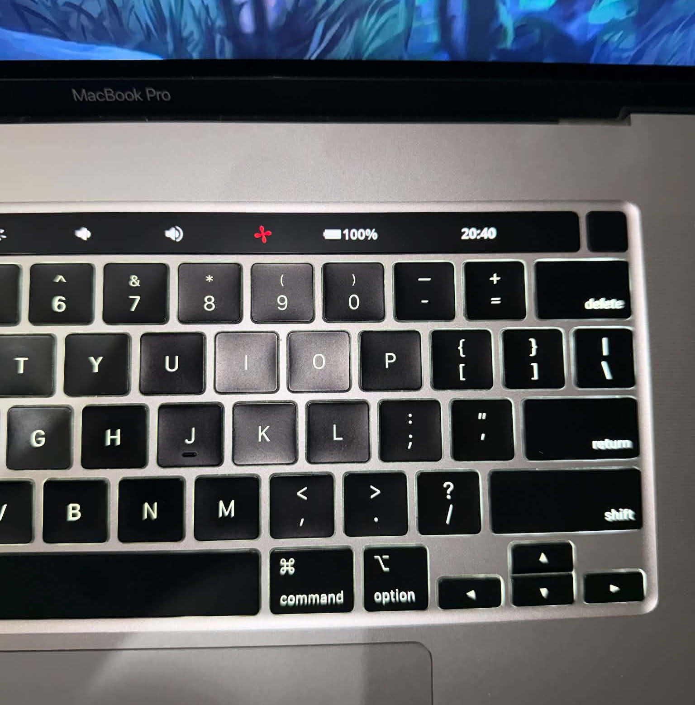

# Simple Fan Control for T2Linux with Touch Bar

[](README.md)
[](docs/README_VI.md)

**Simple Fan Control for T2Linux with Touch Bar** (app name: **T2 Fan Control**) is a small system-tray app for T2 MacBooks running a Linux distribution with the T2Linux stack. It uses [T2FanRD](https://github.com/GnomedDev/T2FanRD) to switch fan policy and optionally integrates with the Touch Bar through `tiny-dfr`.

Tested setup: Ubuntu 26.04, GNOME 50, Wayland, T2FanRD, and [tiny-dfr v0.3.7](https://github.com/AsahiLinux/tiny-dfr/tree/v0.3.7). Other distributions can work when they provide the same T2Linux drivers, services, and desktop dependencies.

## Screenshots

<p align="center">
  
  
</p>

The dashboard shows both fans and the active policy. The Touch Bar indicator is white in Auto and red in Max; this photo shows Max.

## Features

- Compact dashboard showing each fan's RPM and percentage of its maximum.
- Switch between T2FanRD's automatic curve and maximum fan speed.
- White tray icon in Auto, red tray icon in Max.
- Settings for Vietnamese/English and login autostart. The Touch Bar visibility setting appears only when a Touch Bar backlight and tiny-dfr config are detected.
- Optional single Touch Bar fan button: white in Auto, red in Max. It sits immediately inside the battery; battery and clock remain at the outside edge.
- tiny-dfr reloads its config in place when the fan icon changes or the button is shown/hidden. The app does not restart tiny-dfr for these updates.
- A restricted Polkit helper accepts only `auto`, `max`, `toggle`, `touchbar-show`, and `touchbar-hide` operations.

## Requirements

- T2 MacBook with the `macsmc_hwmon` fan driver.
- A Linux distribution with the T2Linux kernel stack, systemd, Polkit, GTK 3, Python GObject, and Ayatana AppIndicator. GNOME needs AppIndicator support for the tray icon.
- T2FanRD installed, with `t2fanrd.service` and `/etc/t2fand.conf`.
- For Touch Bar integration: a detected Touch Bar backlight, [tiny-dfr v0.3.7](https://github.com/AsahiLinux/tiny-dfr/tree/v0.3.7) or newer, and `/etc/tiny-dfr/config.toml`.

## Install

```bash
sudo apt update
sudo apt install python3-gi gir1.2-ayatanaappindicator3-0.1
sudo bash ./install.sh
```

The commands above are for Ubuntu/Debian. On Fedora, Arch, or another distribution, install the equivalent GTK 3, PyGObject, and Ayatana AppIndicator packages with that distribution's package manager, then run `sudo bash ./install.sh`.

The installer places the app, helper, desktop launcher, autostart entry, and icons in system directories. It may ask whether to install the optional Polkit policy that lets the active desktop user change fan mode without a password prompt. If declined, Polkit may ask for authentication when the helper runs.

After installation, sign out and back in or launch **T2 Fan Control** from the app grid. Closing the dashboard hides it in the tray; choose **Quit** from the tray menu to stop the process.

## Touch Bar setup

1. Install tiny-dfr using the T2Linux instructions. The button's key chord requires [tiny-dfr v0.3.7](https://github.com/AsahiLinux/tiny-dfr/tree/v0.3.7) or newer. The optional `update-tiny-dfr.sh` builds official tag v0.3.7 with Cargo and installs a systemd override; it needs network access, build dependencies, Cargo/Git, and sudo. Review that script before running it.
2. Install the icon files:

   ```bash
   bash ./install-touchbar.sh
   ```

3. In **Settings → Keyboard → Custom Shortcuts → Add Shortcut…**, create:

   | Field | Value |
   |---|---|
   | Name | `T2 Fan Toggle` |
   | Command | `pkexec /usr/local/libexec/t2fantray-helper toggle` |
   | Shortcut | `Ctrl+Shift+F11` |

   On the tested GNOME setup, creating this shortcut in GNOME Settings works reliably. The script installs icons but does not create the shortcut.

4. Open T2 Fan Control settings and enable **Touch Bar fan button**. The button appears while the tray app runs, remains when its dashboard is hidden, and is removed when the app exits.

The helper inserts the fan immediately before the Battery entry in `MediaLayerKeys`, leaving Battery and Time at the end of the row. Preserve that order if editing tiny-dfr config manually.

## Update

```bash
git pull
sudo bash ./install.sh
bash ./install-touchbar.sh
```

Quit and relaunch the tray app to load the updated code. The GNOME `T2 Fan Toggle` shortcut remains configured.

## Uninstall

Quit the app, then run:

```bash
sudo bash ./uninstall.sh
```

The uninstaller removes the app, helper, launcher/autostart entries, its Polkit policy and icons, and its Touch Bar button if the helper is still installed. T2FanRD, tiny-dfr, and `/etc/t2fand.conf` remain installed. Remove the manually created `T2 Fan Toggle` shortcut in GNOME Settings. User preferences under `~/.config/t2fantray/` are retained.

## Troubleshooting

See [Troubleshooting](docs/TROUBLESHOOTING.md) for service, shortcut, and Touch Bar checks.

## Sources and acknowledgements

This project is licensed under the [MIT License](LICENSE). Dependency, upstream license, and artwork notices are in [THIRD_PARTY.md](THIRD_PARTY.md).

- [T2FanRD](https://github.com/GnomedDev/T2FanRD) — the fan-control daemon integrated by this app; upstream uses [GPL-3.0](https://github.com/GnomedDev/T2FanRD/blob/master/LICENCE). T2 Fan Control does not contain T2FanRD source code.
- [tiny-dfr](https://github.com/AsahiLinux/tiny-dfr) — the Touch Bar daemon integrated by this app; upstream uses [MIT](https://github.com/AsahiLinux/tiny-dfr/blob/master/LICENSE). The optional updater builds the [v0.3.7 tag](https://github.com/AsahiLinux/tiny-dfr/tree/v0.3.7).
- [T2Linux Wiki: Basic setup](https://wiki.t2linux.org/guides/postinstall/) — installation and configuration guidance for tiny-dfr on T2 Macs.
- [GNOME Help: Set keyboard shortcuts](https://help.gnome.org/gnome-help/keyboard-shortcuts-set.html) — guidance for creating the custom shortcut that invokes the helper.
- [AyatanaIndicators/libayatana-appindicator](https://github.com/AyatanaIndicators/libayatana-appindicator) — GTK 3 AppIndicator library used by the tray UI; upstream provides an [LGPL-3.0 license](https://github.com/AyatanaIndicators/libayatana-appindicator/blob/main/COPYING).
- [GTK](https://www.gtk.org/) and [PyGObject](https://gitlab.gnome.org/GNOME/pygobject) — the GTK 3 toolkit and Python bindings used by the UI.
- `t2fantray.svg`, `fan-auto-white.svg`, and `fan-max-red.svg` are original assets created for this repository; they are not copied from tiny-dfr.

Upstream projects retain their own copyrights and licenses. T2 Fan Control is an independent community project and is not endorsed by T2FanRD, AsahiLinux, T2Linux, GNOME, or AyatanaIndicators.

